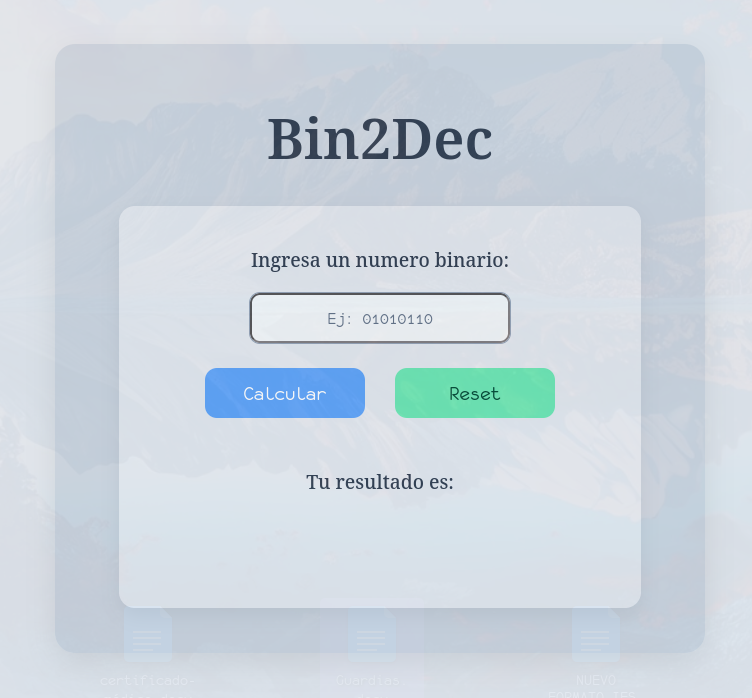

# Bin2Dec — Binary to Decimal Converter

A simple web application that converts binary numbers into decimal numbers. This project was built as part of my JavaScript learning journey, focusing on DOM manipulation, input validation, and event handling.

live demo - https://medgabrielgarcia-star.github.io/bin2decapp/

## Features

- Convert binary numbers into decimal numbers.
- Validate user input to accept only binary digits (`0` and `1`).
- Display the conversion result directly in the interface.
- Clear the input field and result using the reset button.
- Responsive and user-friendly interface.

## Technologies Used

- HTML5
- CSS3
- JavaScript (Vanilla JS)

## How to Use

1. Enter a binary number using only `0` and `1`.
2. Click the convert button to calculate its decimal equivalent.
3. View the result displayed on the page.
4. Use the reset button to clear the input and result.

## What I Learned

- Manipulating the DOM with JavaScript.
- Handling user events and button interactions.
- Validating user input.
- Converting binary numbers to decimal.
- Updating the interface dynamically.
- Separating HTML, CSS, and JavaScript into different files.

## Project Reference

This project was inspired by the **Bin2Dec** challenge from the App Ideas Collection.

- [Original Project — Bin2Dec](https://github.com/florinpop17/app-ideas/blob/master/Projects/1-Beginner/Bin2Dec-App.md)

---

**Status:** Completed ✅

**Author:** Gabriel García